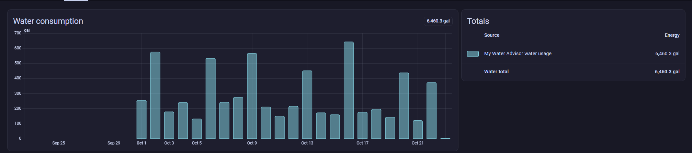

<h1 align="center">💧 My Water Advisor for Home Assistant</h1>

<p align="center">
  <strong>Hourly water usage from your utility's My Water Advisor portal, in the Home Assistant Energy dashboard.</strong>
</p>

<p align="center">
  <a href="https://github.com/hacs/integration"></a>
  <a href="https://github.com/suschatt/ha-mywateradvisor/releases"></a>
  <a href="https://github.com/suschatt/ha-mywateradvisor/actions/workflows/validate.yml"></a>
  
  
</p>

<p align="center">
  
</p>

---

If your water utility gives you a **My Water Advisor** login (mywateradvisor2.com)
to see your smart-meter usage, this integration brings that data into Home
Assistant: hourly readings, placed at the hour the water was used, with no
extra hardware.

> [!NOTE]
> **Unofficial.** Not affiliated with, endorsed by, or supported by Master
> Meter, Inc., Harmony, or any water utility. It reads the same undocumented
> API the portal's website uses, which can change without notice. The portal's
> Terms of Use restrict automated access without written consent; check with
> your utility before relying on it.

## ✨ Features

| Feature | What it does |
|---|---|
| 📊 **Energy dashboard ready** | One long-term statistic per meter, selectable as a water source. |
| ⏱️ **Hourly detail** | Usage lands in the hour it happened, not the hour it was downloaded. |
| 🕰️ **History backfill** | Imports up to 365 days on first setup (default 30). |
| 🔄 **Self-correcting** | Re-reads the last 3 days on every update, so late or corrected readings are fixed. Correction readings cancel the spike they correct. |
| 🔐 **UI setup** | Sign in from Home Assistant's integrations page. No YAML, tokens, or extra servers. |
| 🛡️ **Lockout-safe** | Backs off when the portal refuses a login and caps background logins at 8 a day, across restarts. |
| ⚙️ **Configurable** | Poll interval (1-24 h) and how your portal labels its hours, under **Configure**. |
| 🔁 **Re-auth prompt** | If your password changes, Home Assistant asks for the new one. |

## 🏙️ Utilities

My Water Advisor is used by many utilities with Master Meter smart meters.

| Utility | Area | Unit | Status |
|---|---|---|---|
| Travis County WCID 17 | Lake Travis, Steiner Ranch, TX | gallons | ✅ Tested |
| *Yours?* | | | [Tell us](https://github.com/suschatt/ha-mywateradvisor/issues/new) |

If it works for your utility, open an issue with the utility name and unit so
it can be added here.

---

## 🚀 Getting started

### Step 1: Have a My Water Advisor account

Check you can sign in at **mywateradvisor2.com** and see hourly usage
(the **Hourly** tab on the usage chart).

No account yet? Register at mywateradvisor2.com/register. You'll need your
**utility account number** from your water bill.

### Step 2: Install with HACS

[](https://my.home-assistant.io/redirect/hacs_repository/?owner=suschatt&repository=ha-mywateradvisor&category=integration)

Or do it by hand:

1. Open **HACS** in Home Assistant.
2. Open the **⋮** menu (top right) → **Custom repositories**.
3. Repository: `https://github.com/suschatt/ha-mywateradvisor`, Type: **Integration** → **Add**.
4. Search for **My Water Advisor** → **Download**.
5. **Restart Home Assistant** (Settings → System → ⏻ → Restart).

<details>
<summary>Manual install without HACS</summary>

1. Download the latest release and unzip it.
2. Copy the `custom_components/mywateradvisor` folder into your Home Assistant
   `config/custom_components/` folder (create it if it doesn't exist).
3. Restart Home Assistant.

You won't get update notifications this way.
</details>

### Step 3: Add the integration

[](https://my.home-assistant.io/redirect/config_flow_start/?domain=mywateradvisor)

Or go to **Settings → Devices & services → + Add integration** and search for
**My Water Advisor**. Fill in:

| Field | What to enter |
|---|---|
| **Email** | The email you sign in to mywateradvisor2.com with. |
| **Password** | Your portal password. |
| **Unit** | The unit your portal shows on its usage chart. **WCID 17: Gallons.** Values are not converted, so pick the matching unit. |
| **Days of history** | How far back to import the first time. 30 is a good start; up to 365. |

Click **Submit**. The history import runs in the background and takes about
a minute for 30 days, or several minutes for a full year.

### Step 4: Add it to the Energy dashboard

1. Go to **Settings → Dashboards → Energy**.
2. Under **Water consumption**, click **Add water source**.
3. Pick **My Water Advisor meter &lt;your meter number&gt;** → **Save**.
4. Open the **Energy** dashboard and choose the **Water** tab.

> [!TIP]
> The statistic can take a minute or two to appear in the picker after the
> first import. If it isn't there, wait and reopen the dialog.

---

## 📖 Using your data

### See hourly usage

On the Energy dashboard, pick a single day with the date selector at the top.
The water chart switches to hourly bars. Week and month views show daily bars.

### Add a usage card to any dashboard

A **Statistics graph** card works with the imported statistic anywhere in
Home Assistant. Edit a dashboard → **Add card** → **Manual**, and paste
(replace the meter number with yours):

```yaml
type: statistics-graph
title: Water use (last 30 days)
entities:
  - mywateradvisor:water_221370217
stat_types:
  - change
period: day
chart_type: bar
days_to_show: 30
```

Change `period: day` to `hour` with `days_to_show: 2` to spot leaks such as
steady overnight use.

> [!TIP]
> To find your statistic ID, go to **Developer tools → Statistics** and search
> for `My Water Advisor`.

### Check it matches your bill

The integration only copies what the portal reports. For any finished day, the
Energy dashboard total should equal the portal's **Daily** view, and the month
total should match the portal's **Billing Month** view. When the portal posts
a negative correction reading, it's subtracted from the hours just before it,
so a bad spike and its correction cancel out.

---

## ⚙️ How updates work

```
Every poll interval (default 4 hours)
  └─ reuse the session, or sign in if the login guard allows it
  └─ list the meters on your account
  └─ for each meter:
       ├─ read hourly usage from 3 days before the last imported hour up to today
       │    (at most 7 days before the last completed check)
       ├─ hold back hours the portal hasn't reported yet (trailing zeros or estimates)
       ├─ cancel negative correction readings against the hours before them
       └─ write them to Home Assistant's long-term statistics (overwriting corrections)
```

- **Data is late.** Smart meters upload a few times a day, and the portal is
  often a day or more behind. Yesterday's afternoon may not appear until today.
- **Trailing zeros wait.** The portal fills hours it hasn't received yet with
  `0`. Those aren't imported until a later nonzero reading confirms them, so
  you won't see fake zero-usage hours.
- **Estimates wait too.** Hours the portal marks as estimated are held back at
  the end of the data until the real reading arrives.
- **Very late data is skipped.** Readings that reach the portal more than
  7 days after the hour they belong to are not picked up.
- **Time zone.** Portal hours are local clock times. The integration uses your
  Home Assistant time zone (Settings → System → General), which must match
  your utility's.

### Login protection

The portal has been seen refusing logins with HTTP 400 for about a day, with
the correct password, while it temporarily locked the account. So:

- The integration signs in only when it has no session. Setup itself doesn't
  sign in.
- Only HTTP 401 counts as a wrong password. A 400, 403 or 429 makes it wait
  15 minutes, then 30, 60 and so on up to 6 hours (longer if the portal sends
  `Retry-After`). You're asked for the password only after 4 refusals in a
  row, spread over about 4 hours.
- Background logins are capped at 8 per rolling 24 hours.
- This state is kept in Home Assistant's `.storage` folder, so restarts don't
  reset it. Entering the password again clears it.

---

## 🔧 Options

**Settings → Devices & services → My Water Advisor → Configure.** Saving
reloads the integration.

| Option | What it does |
|---|---|
| **Check the portal every** | 1 to 24 hours (default 4). The portal posts readings in batches, often a day late, so polling more often gains little and costs logins. |
| **Portal hour labels mark** | Whether a portal label like 11:00 means usage from 11:00 to 12:00 (*start*, the default) or from 10:00 to 11:00 (*end*). Pick one day with a distinctive hour, such as a shower or irrigation run, and compare the portal's **Hourly** chart with the Energy dashboard. If usage shows up an hour off, switch this. It only affects newly imported hours; to re-import history, remove and re-add the integration. |

---

## 🛠️ Troubleshooting

| Problem | What to do |
|---|---|
| **"The portal rejected the email or password."** | Sign in at mywateradvisor2.com with the same details. Reset your password there if needed. |
| **"Signed in, but no meters are linked to this account."** | Your portal account isn't linked to a utility account yet. Finish registration with your account number. |
| **Nothing in the Energy picker** | Wait a couple of minutes after setup. Then check **Developer tools → Statistics** for `My Water Advisor`. |
| **Today's usage is missing** | Normal: the portal is behind. Check the portal; if it's there too, wait for the next update (your poll interval) or reload the integration. |
| **"The portal refused the login."** or *Holding off login* in the log | The portal refused a login (often a temporary lock). The integration retries on its own with growing delays; don't reload repeatedly. If the browser can't sign in either, wait it out. The log shows the portal's message. |
| **Wrong unit or numbers off by a factor** | The **Unit** setting doesn't match your portal. Delete the statistic in **Developer tools → Statistics**, then remove and re-add the integration with the right unit. |
| **Bars are exactly one hour off** | Switch **Portal hour labels mark** under **Configure**. |
| **Bars are a few hours off** | Your Home Assistant time zone doesn't match your utility's. |

### Debug logging

Refused logins and failed requests are always logged as warnings, with the
portal's status code and message (never your password or session token).

For more detail, open **Settings → Devices & services → My Water Advisor** and
choose **Enable debug logging**. Each update then logs the hours imported and
the last reported hour. Include those lines (without your email) when opening
an issue.

---

## ❓ FAQ

<details>
<summary><strong>Why are there no sensors?</strong></summary>

The Energy dashboard reads long-term statistics, and hourly data that arrives
a day late can only be placed at the right hour by writing statistics
directly. A sensor would show the usage at the time it was downloaded instead.
</details>

<details>
<summary><strong>Is my password safe?</strong></summary>

It's stored in Home Assistant's config entry storage, like every other cloud
integration that signs in with a password, and is only sent to the portal's
login endpoint over HTTPS. It never appears in the log.
</details>

<details>
<summary><strong>I have more than one meter.</strong></summary>

Each meter gets its own statistic. This is supported but hasn't been tested
with a real multi-meter account yet. Please open an issue with your results.
</details>

<details>
<summary><strong>How do I remove it, and does it delete my history?</strong></summary>

Settings → Devices & services → My Water Advisor → ⋮ → **Delete**. The imported
history stays. To delete it as well, go to **Developer tools → Statistics**,
find `My Water Advisor meter …`, and remove it.
</details>

<details>
<summary><strong>Can I import more history later?</strong></summary>

The backfill only runs the first time. To import more, delete the statistic
(see above), remove the integration, and add it again with a larger number of
days.
</details>

---

## 🤝 Contributing

Issues and pull requests are welcome, especially reports from other utilities.

To run the tests (Python 3.14, which current Home Assistant needs; on Windows
use WSL, since Home Assistant's test dependencies don't build natively):

```bash
pip install -r requirements_test.txt
pytest
```

The tests run the integration against a real Home Assistant recorder using
recorded portal data, including daylight-saving changes and multi-meter
accounts.

## 📄 License

[MIT](LICENSE). "My Water Advisor" is a trademark of its owner and is used
here only to describe compatibility.
